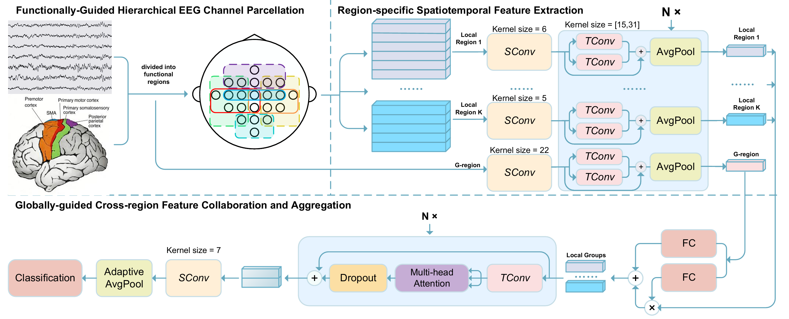
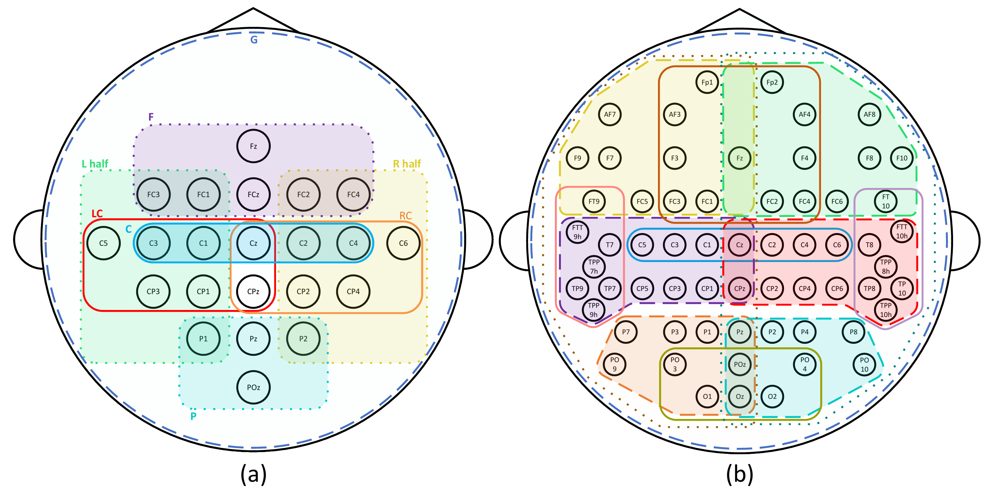

# NeuroGuideNet

## Paper overview

**NeuroGuideNet: A functionally-guided hierarchical network with global–local collaboration for EEG motor imagery decoding**

Zihang Wang, Shichao Cheng, Hongyu Liu, Zhangze Xu, Xin Zhou, and Jianhai Zhang. [Paper (DOI)](https://doi.org/10.1016/j.bspc.2026.111897)

This repository contains the official implementation of NeuroGuideNet. The paper’s first author, Zihang Wang, provided the code.

NeuroGuideNet decodes motor imagery from EEG by learning patterns within and across functional brain regions. It groups EEG channels by electrode location and the neuroanatomy of motor imagery, then extracts spatiotemporal features at multiple scales within each group. A global representation modulates these regional features, and spatiotemporal attention combines information across regions.

The paper reports average accuracy improvements of 1.83% on BCIC-IV-2A and 1.7% on OpenBMI over the compared state-of-the-art methods. Ablation studies also support the contribution of the individual modules and the anatomically guided channel grouping.

### Model architecture





## Environment setup

Use **Python 3.9**. The dependency versions in [requirement.txt](requirement.txt) were taken from the local Conda `Research` environment with Python 3.9.19 and PyTorch 2.3.1.

From the repository root, create a Conda environment and install the dependencies. The commands below select the CPU build of PyTorch on Windows and Linux. The first pip command installs the PyTorch wheel, and the second resolves the project dependencies from PyPI.

```bash
conda create -n neuroguidenet python=3.9.19 pip
conda activate neuroguidenet
python -m pip install --no-deps torch==2.3.1 --index-url https://download.pytorch.org/whl/cpu
python -m pip install -r requirement.txt
python -m pip check
```

For an NVIDIA GPU with a driver that supports CUDA 12.1, use the CUDA 12.1 wheel below. After installing the dependencies, check CUDA availability and follow the device setting in [Usage](#usage). See the [official PyTorch 2.3.1 installation instructions](https://pytorch.org/get-started/previous-versions/#v231).

```bash
python -m pip install --no-deps torch==2.3.1 --index-url https://download.pytorch.org/whl/cu121
python -m pip install -r requirement.txt
python -m pip check
python -c "import torch; print(torch.cuda.is_available())"
```

## Dataset

### BCI Competition IV-2a dataset

Download **BCI Competition IV-2a dataset (BCIC-IV-2A)** from the official BBCI website.

1. **EEG recordings (`.gdf`)** — Open the [official download page](https://bbci.de/competition/iv/download/) and select **GDF files zipped** under **Data sets 2a**. Extract the recordings into `BCICIV_2a_gdf/`.
2. **Evaluation labels (`.mat`)** — On the [official results page](https://www.bbci.de/competition/iv/results/#labels), select **labels** next to **Data sets 2a** to download [`true_labels`](https://www.bbci.de/competition/iv/results/ds2a/true_labels.zip). Move the resulting `true_labels` folder into `BCICIV_2a_gdf/` so the label files are in `BCICIV_2a_gdf/true_labels/`.

The directory tree below shows the files for subject `A01`.

```text
BCICIV_2a_gdf/
├── A01T.gdf          # Training-session recording
├── A01E.gdf          # Evaluation-session recording
├── ...
└── true_labels/
    ├── A01T.mat      # Training-session labels
    ├── A01E.mat      # Evaluation-session labels
    └── ...
```

The same layout applies to all nine subjects, `A01` through `A09`. Each
`.gdf` recording has a matching `.mat` label file with the same base name
in `true_labels/`.

Set `dataset.root` in [the BCI IV-2a configuration](config/BCIIV2a_NeuroGuideNet.yaml) to your local `BCICIV_2a_gdf/` directory.

### OpenBMI dataset

NeuroGuideNet uses the motor imagery (MI) recordings from the [official OpenBMI dataset on GigaDB (DOI 10.5524/100542)](https://doi.org/10.5524/100542).

GigaDB organizes the recordings in session and subject folders, for example `session1/s1/sess01_subj01_EEG_MI.mat`.

The [data loader](dataset/OpenBMI_data_mat.py) reads each `sessNN_subjNN_EEG_MI.mat` file directly from `dataset.root`. The local directory below shows the files for subject 1 in both sessions.

```text
OpenBMI/
├── sess01_subj01_EEG_MI.mat
├── sess02_subj01_EEG_MI.mat
└── ...
```

- **Manual download** — Download only the `*_EEG_MI.mat` files for the subjects and sessions you plan to use. The other files in the GigaDB record, including ERP and SSVEP recordings, can be skipped. Keep the original filenames and place the files directly in `OpenBMI/`.
- **Scripted download** — Install the optional download dependency and run the script from the repository root. It saves the MI files for both sessions directly in the directory specified by `--save-dir`.

  ```bash
  python -m pip install pySmartDL==1.3.4
  python dataset/OpenBMI_download.py --save-dir Dataset/OpenBMI
  ```

Set `dataset.root` in [the OpenBMI configuration](config/OpenBMI_NeuroGuideNet.yaml) to your local `OpenBMI/` directory.

## Usage

1. Prepare one of the datasets above and set `dataset.root` in its YAML file to the folder containing your recordings.
2. In [main.py](main.py), select the matching `config_file`. BCI IV-2a is selected by default. For OpenBMI, switch to `config/OpenBMI_NeuroGuideNet.yaml`.
3. Choose the device in the same file. The default is `cfg['device'] = 'cpu'`. For an NVIDIA GPU with CUDA-enabled PyTorch, set it to `'cuda'`.
4. By default, the script trains and evaluates a separate model for each of the 9 BCI IV-2a subjects or 54 OpenBMI subjects. For a single-subject run, set `subject_list = ['1']` immediately before the line that logs the subject list. To change the training duration, edit `train.epoch` in the selected YAML file.
5. From the repository root, run the experiment.

   ```bash
   python main.py
   ```

After all selected subjects finish, open `log/Temp/BCIIV2a_avg_df.csv` or `log/Temp/OpenBMI_avg_df.csv`. Each subject row reports training and test loss, accuracy, and Cohen’s kappa. The final `_avg` row gives the mean across the selected subjects.

## Project structure

[main.py](main.py) runs motor imagery classification experiments one subject at a time. It reads the selected YAML file from [config/](config/), calls the trainer, and writes per-subject metrics and their averages to a CSV file under `log/Temp/`.

| File | Purpose |
| --- | --- |
| [trainer.py](trainer.py) | Builds the data loaders, trains the model, and evaluates loss, accuracy, and Cohen’s kappa. |
| [model/NeuroGuideNet.py](model/NeuroGuideNet.py) | Defines the channel groups for each dataset and the network that extracts features within brain regions and learns relationships across regions. |
| [dataset/BCIIV2a_data_gdf.py](dataset/BCIIV2a_data_gdf.py) | Reads BCI IV-2a GDF recordings and MAT labels, segments the EEG into trials, and exposes them as a PyTorch dataset. |
| [dataset/OpenBMI_data_mat.py](dataset/OpenBMI_data_mat.py) | Reads OpenBMI MAT files by subject and session, resamples and filters the EEG, and extracts labeled trials. |
| [dataset/OpenBMI_download.py](dataset/OpenBMI_download.py) | Downloads motor imagery recordings for both OpenBMI sessions into the selected directory. |
| [transform.py](transform.py) | Implements EEG augmentations including random cropping, noise addition, segment reassembly, and left–right channel flips. |
| [utils.py](utils.py) | Provides signal standardization, loss functions, learning rate scheduling, logging, and confusion matrix utilities. |

## Citation

If you use NeuroGuideNet in your research, please cite the following paper.

```bibtex
@article{WANG2027111897,
title = {NeuroGuideNet: A functionally-guided hierarchical network with global–local collaboration for EEG motor imagery decoding},
journal = {Biomedical Signal Processing and Control},
volume = {131},
pages = {111897},
year = {2027},
issn = {1746-8094},
doi = {https://doi.org/10.1016/j.bspc.2026.111897},
url = {https://www.sciencedirect.com/science/article/pii/S1746809426024559},
author = {Zihang Wang and Shichao Cheng and Hongyu Liu and Zhangze Xu and Xin Zhou and Jianhai Zhang},
keywords = {Brain–computer interface, Motor imagery, Neuroanatomical prior, Neural network},
abstract = {Motor imagery-based brain–computer interface (MI-BCI) relies on decoding high-dimensional and noisy electroencephalography (EEG) signals that exhibit complex spatiotemporal dynamics. Existing deep learning approaches often emphasize temporal features while neglecting functional neuroanatomical priors, which may hinder the modeling of region-specific spatial patterns and inter-regional interactions associated with motor imagery. To address these issues, we propose NeuroGuideNet, a functionally-guided hierarchical network with global–local collaboration which integrates neuroanatomical knowledge into EEG decoding. Specifically, EEG signals are divided into several functional regions according to the neuroanatomy of motor imagery and electrode placement, enabling region-wise feature learning and emphasizing EEG representations from task-relevant functional regions. Then, a region-specific spatiotemporal feature extraction module captures multi-scale spatiotemporal dynamics within each region. Subsequently, a globally-guided cross-region feature collaboration and aggregation mechanism merges the features across regions using globally-conditioned feature modulation and spatiotemporal attention to model global dependencies. Extensive evaluations on the BCIC-IV-2A and OpenBMI datasets demonstrate that NeuroGuideNet outperforms state-of-the-art methods, with average accuracy improvements of 1.83% and 1.7%, respectively. Ablation studies further confirm the importance of each module and the neurophysiologically guided channel partitioning.}
}
```
